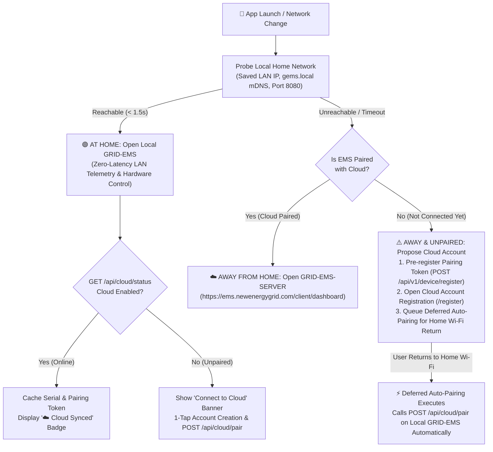

# GRID-EMS-APP — iOS & Android Mobile Companion

Official cross-platform mobile companion application (**iOS** & **Android**) for **GRID-EMS** (Local Edge Energy Management System) and **GRID-EMS-SERVER** (`https://ems.newenergygrid.com`), engineered by **New Energy Grid** and **The Charge Grid**.

---

## 📦 Download Latest Release (`v1.0.0`)

Pre-built installation packages for Android and iOS are published on the [**GitHub Releases**](https://github.com/webdotpulse/GRID-EMS-APP/releases/latest) page:

| Platform | Release Asset | Description |
| :--- | :--- | :--- |
| **Android (8.0+)** | [`GRID-EMS-v1.0.0-android.apk`](https://github.com/webdotpulse/GRID-EMS-APP/releases/latest/download/GRID-EMS-v1.0.0-android.apk) | Ready-to-install Android APK package with local mDNS/LAN discovery and cloud failover |
| **iOS (15.0+)** | [`GRID-EMS-v1.0.0-ios.ipa`](https://github.com/webdotpulse/GRID-EMS-APP/releases/latest/download/GRID-EMS-v1.0.0-ios.ipa) | Unsigned ARM64 iOS `.ipa` application bundle for sideloading (AltStore / Sideloadly / Apple Configurator 2) or enterprise/developer signing |
| **iOS (Xcode)** | [`GRID-EMS-v1.0.0-ios-xcode.zip`](https://github.com/webdotpulse/GRID-EMS-APP/releases/latest/download/GRID-EMS-v1.0.0-ios-xcode.zip) | Complete pre-synced Xcode project archive (`ios/App/App.xcworkspace`) ready to sign and run on any iPhone or iPad |
| **Checksums** | [`SHA256SUMS`](https://github.com/webdotpulse/GRID-EMS-APP/releases/latest/download/SHA256SUMS) | SHA-256 cryptographic checksums for all release artifacts |

---

## 🧭 Smart Local & Cloud Routing Architecture

`GRID-EMS-APP` automatically detects whether the user is **at home** on their local Wi-Fi network or **away from home** on cellular/external Wi-Fi, and adapts its behavior based on whether the `GRID-EMS` edge controller is already paired with `GRID-EMS-SERVER`:



---

## ✨ Key Capabilities

1. **Zero-Latency Local Edge Control (At Home)**
   - Automatically discovers your `GRID-EMS` Raspberry Pi controller via mDNS (`gems.local` / `grid-ems.local`), saved LAN IP, or built-in subnet scanner (`8080`).
   - Provides both a **Mobile Quick Dashboard** (live Solar PV, **Solis** battery storage SoC & strategy selector, 3-phase Grid Meter with Monthly Capacity Peak tracking, and **Raedian** EV wallbox charging mode control: `ECO`, `SOLAR`, `FAST`, `OFF`) and an **Embedded Local Portal** view.

2. **Automatic Cloud Failover (Away from Home)**
   - When your phone leaves your home Wi-Fi, the app automatically switches to **GRID-EMS-SERVER** (`https://ems.newenergygrid.com/client/dashboard` or your organization's white-label tenant portal `https://ems.newenergygrid.com/<tenant>/dashboard`).

3. **One-Tap Cloud Account Proposal & Deferred Auto-Pairing**
   - **When at home (unpaired):** Displays an onboarding prompt that calls `POST /api/cloud/pair` on the local `GRID-EMS` and opens the cloud registration page with your hardware `pairing_token` pre-filled.
   - **When away from home (unpaired):** Proposes creating a `GRID-EMS-SERVER` account immediately, pre-registers the hardware `pairing_token` in the cloud (`POST /api/v1/device/register`), and queues a **Deferred Auto-Pairing** job that automatically pairs the local `GRID-EMS` the instant your phone reconnects to your home Wi-Fi.

4. **Multilingual Interface (`EN`, `NL`, `FR`) & Dark/Light Theme**
   - Full localization in **English**, **Nederlands**, and **Français**, matching `GRID-EMS` and `GRID-EMS-SERVER`.

---

## 📲 Installation Guide

### Android (`GRID-EMS-v1.0.0-android.apk`)
1. Download [`GRID-EMS-v1.0.0-android.apk`](https://github.com/webdotpulse/GRID-EMS-APP/releases/latest/download/GRID-EMS-v1.0.0-android.apk) on your Android phone.
2. Open the downloaded `.apk` file and allow installation from your browser/file manager if prompted.
3. Launch **GRID-EMS** while connected to your home Wi-Fi to automatically discover your local `GRID-EMS` controller, or while away from home to connect to `GRID-EMS-SERVER`.

### iOS (`GRID-EMS-v1.0.0-ios.ipa` or `GRID-EMS-v1.0.0-ios-xcode.zip`)
* **Option A — Install via Sideloading (`GRID-EMS-v1.0.0-ios.ipa`):**
  1. Download [`GRID-EMS-v1.0.0-ios.ipa`](https://github.com/webdotpulse/GRID-EMS-APP/releases/latest/download/GRID-EMS-v1.0.0-ios.ipa).
  2. Install onto your iPhone or iPad using **AltStore**, **Sideloadly**, **Apple Configurator 2**, or your organization's MDM / Ad-Hoc provisioning profile.
  3. On first launch, tap **Allow** when iOS asks for permission to find and connect to devices on your local network (`NSLocalNetworkUsageDescription`).
* **Option B — Build & Run Directly via Xcode (`GRID-EMS-v1.0.0-ios-xcode.zip`):**
  1. Extract `GRID-EMS-v1.0.0-ios-xcode.zip` (or clone this repository and run `npm run mobile:build`).
  2. Open `ios/App/App.xcworkspace` in Xcode on macOS.
  3. Select your Apple ID / Development Team under **Signing & Capabilities**, connect your iPhone, and press **Run (⌘R)**.

---

## 🛠️ Local Development & Build Commands

### Prerequisites
- **Node.js** `20+` or `22+`
- **Android Studio** / Android SDK & JDK 21 (for local Android builds)
- **Xcode 16+** & CocoaPods on macOS (for local iOS builds)

### Commands

```bash
# 1. Install dependencies
npm install

# 2. Run automated unit & integration tests (Vitest)
npm test

# 3. Start local development server with hot reload
npm run dev

# 4. Build production web bundle & sync to native iOS + Android projects
npm run mobile:build

# 5. Open native IDEs
npm run cap:android   # Opens Android Studio
npm run cap:ios       # Opens Xcode
```

---

## 🔒 Security & Brand Compliance

**GRID-EMS-APP** is a proprietary software asset owned exclusively by **New Energy Grid** and **The Charge Grid**. All local network communications support LAN HTTP and local CA certificates, while all cloud communications with `ems.newenergygrid.com` strictly enforce HTTPS/TLS.
